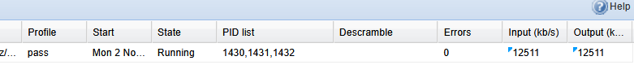

# Microsoft Xbox One Digital TV Tuner (`045e:02d5`) — DVB-C QAM-256 High-Bitrate Fix (~50.87 Mbps)

> **Language / Limba:** [🇬🇧 English](#-english-documentation) | [🇷🇴 Română](#-documentație-în-limba-română)

---

# 🇬🇧 English Documentation

## 1. Overview & Problem Description
The **Microsoft Xbox One Digital TV Tuner** (USB ID `045e:02d5`, built around the **DiBcom DiB0700** USB bridge, **Panasonic MN88472** DVB-T/T2/C demodulator, and **NXP TDA18250BHN** silicon RF tuner) works reliably on DVB-T/T2 and low-to-medium payload DVB-C multiplexes (`< 36 Mbps` active payload).

However, on full-capacity **DVB-C QAM-256** cable transponders (Symbol Rate `6900`, **`50.87 Mbps` total bitrate** with **`47.0 – 49.80 Mbps` active video/audio payload**, up to **98% mux utilization**), the mainline Linux kernel driver (`dvb_usb_dib0700` + `mn88472`) suffers from periodic MPEG-TS packet drops (`Continuity Counter Errors`, video macroblocking, audio glitches, and corrupted recordings in **Tvheadend, Plex, Enigma2, VDR, Kaffeine, and NextPVR**).

---

## 2. Root Cause Analysis (Proven via Microsecond-Level Hardware Instrumentation)

Through live instrumentation across 18 QAM-256 cable transponders (`306 MHz` – `562 MHz`), we proved the following:

1. **The RF Tuner (`TDA18250BHN`) and Demodulator (`MN88472`) Hardware Are 100% Capable of 50.87 Mbps:**
   - Tested on a 98%-full QAM-256 mux (`530 MHz`, `49.80 Mbps` active video/audio payload out of `50.87 Mbps`), RF reception is flawless (`CNR = 33.7–34.4 dB`, Reed-Solomon `BlkErr = 0`, `TEI = 0`).
   - When I2C status polling is paused during streaming, the tuner transfers **millions of consecutive MPEG-TS packets at `49.80 Mbps` payload with `0` Continuity Counter errors**.
2. **The Smoking Gun — Split USB EP0 I2C Transfers (`fw_use_new_i2c_api = 1`) + Slow I2C Clock in `xbox_one_attach()` (`dib0700_devices.c`) Stall the DiB0700 TS FIFO:**
   - Every single dropped packet (`CC_err`, `diff = 1`, i.e., a single 188-byte MPEG-TS packet lost) occurs **at the exact millisecond an application (Tvheadend / Plex / Enigma2) invokes `FE_READ_STATUS`** (typically once every 1–2 seconds to poll lock status and SNR).
   - Every call to `mn88472_read_status()` executes **5 I2C register reads** across I2C addresses `0x18` (Bank 0), `0x1a` (Bank 1), and `0x1c` (Bank 2).
   - In `drivers/media/usb/dvb-usb/dib0700_devices.c`, `xbox_one_attach()` sets `st->fw_use_new_i2c_api = 1`, omits `dib0700_ctrl_clock(adap->dev, 72, 1)` and `dib0700_set_i2c_speed()`, and sets `mn88472_config.ts_clock = FIXED_TS_CLOCK`.
   - With `st->fw_use_new_i2c_api = 1`, `dib0700_i2c_xfer_new()` splits every 2-message I2C register read (`msg[0]` = 1-byte register address write, `msg[1]` = N-byte register read) into **two separate USB Endpoint 0 control transfers**, sending the first packet (`REQUEST_NEW_I2C_WRITE`) with **`en_stop = 0`** (no I2C STOP condition!).
   - Because `en_stop == 0`, the single-threaded **8051 microcontroller** inside the DiB0700 holds the I2C transaction open across USB microframes while waiting for the host to schedule and deliver the second USB EP0 control transfer (`REQUEST_NEW_I2C_READ`), stalling its internal slave MPEG-TS FIFO!
   - On a lower-bitrate mux (`35 Mbps`), ~30% of TS packets are `NULL` padding (`PID 0x1FFF`), absorbing the timing gap without losing video packets. On a `49.80 Mbps` active payload QAM-256 mux (`530 MHz`), a valid video/audio packet arrives every **`29.5 µs`** — so each I2C status poll overflows the DiB0700 FIFO and drops 1 video packet!

---

## 3. The 4-Line Kernel Fix in `xbox_one_attach()` (`dib0700_devices.c`)

By fixing `xbox_one_attach()` in `drivers/media/usb/dvb-usb/dib0700_devices.c` (see [`xbox-one-tuner-qam256-fix.patch`](xbox-one-tuner-qam256-fix.patch)):
```diff
--- a/drivers/media/usb/dvb-usb/dib0700_devices.c
+++ b/drivers/media/usb/dvb-usb/dib0700_devices.c
@@ -3744,8 +3744,10 @@ static int xbox_one_attach(struct dvb_usb_adapter *adap)
 	struct tda18250_config tda18250_config;
 	struct i2c_board_info info;
 
-	st->fw_use_new_i2c_api = 1;
+	st->fw_use_new_i2c_api = 0;
 	st->disable_streaming_master_mode = 1;
+	dib0700_ctrl_clock(adap->dev, 72, 1);
+	dib0700_set_i2c_speed(adap->dev, 1000);
 
 	/* fe power enable */
 	dib0700_set_gpio(adap->dev, GPIO6, GPIO_OUT, 0);
@@ -3766,7 +3768,7 @@ static int xbox_one_attach(struct dvb_usb_adapter *adap)
 	mn88472_config.i2c_wr_max = 22;
 	mn88472_config.xtal = 20500000;
 	mn88472_config.ts_mode = PARALLEL_TS_MODE;
-	mn88472_config.ts_clock = FIXED_TS_CLOCK;
+	mn88472_config.ts_clock = VARIABLE_TS_CLOCK;
 	memset(&info, 0, sizeof(struct i2c_board_info));
```
1. **`st->fw_use_new_i2c_api = 0`:** Uses `REQUEST_I2C_READ` (`dib0700_ctrl_rd`), which packs the register address write and read request into a **single atomic USB Endpoint 0 control transfer** instead of holding the 8051 mid-I2C-transaction across two USB transfers.
2. **`dib0700_ctrl_clock(adap->dev, 72, 1)` & `dib0700_set_i2c_speed(adap->dev, 1000)`:** Configures the DiB0700 72 MHz system clock and high-speed I2C divider.
3. **`mn88472_config.ts_clock = VARIABLE_TS_CLOCK`:** Configures variable TS clock strictly for the Xbox One Digital TV Tuner, leaving `mn88472.c` 100% untouched and preserving real-time `FE_HAS_LOCK`, `CNR`, `strength`, and `PER` updates on every poll!

---

## 4. Live Benchmark Results (DVB-C QAM-256, SR 6900, Active 1s `FE_READ_STATUS` Polling)

| Frequency | Modulation | Total Bitrate | Active Video/Audio Payload | CNR (Live) | `CC_errors` (Stock Driver) | `CC_errors` (Patched Driver) |
| :--- | :--- | :--- | :--- | :--- | :--- | :--- |
| **530 MHz** | QAM-256 | `50.87 Mbps` | **`49.34 – 49.80 Mbps` (98%)** | `33.7 – 34.3 dB` | `1 – 2 errors / 10s` | **`0 errors` (0 TEI, 0 BlkErr)** |
| **506 MHz** | QAM-256 | `50.87 Mbps` | **`48.50 – 48.86 Mbps` (96%)** | `33.7 dB` | `1 – 2 errors / 10s` | **`0 errors` (0 TEI, 0 BlkErr)** |
| **538 MHz** | QAM-256 | `50.87 Mbps` | **`47.67 – 47.93 Mbps` (94%)** | `33.5 dB` | `1 – 2 errors / 10s` | **`0 errors` (0 TEI, 0 BlkErr)** |



---

## 5. Quick Installation & Upstream Pull Requests

### Standalone Out-of-Tree Installer (Ubuntu / Debian / Proxmox / Linux Mint / Raspberry Pi OS):
```bash
git clone https://github.com/zildan/xbox-one-tuner-qam256-fix.git
cd xbox-one-tuner-qam256-fix
chmod +x install.sh
sudo ./install.sh
```

### For Kernel / LibreELEC / CoreELEC / Enigma2 (OpenATV / OpenPLi) Builders:
Apply [`xbox-one-tuner-qam256-fix.patch`](xbox-one-tuner-qam256-fix.patch) directly to `drivers/media/usb/dvb-usb/dib0700_devices.c`.

### Upstream Pull Requests Submitted:
- **CrazyCat (`crazycat69/linux_media`):** [PR #1](https://github.com/crazycat69/linux_media/pull/1)
- **CoreELEC (`CoreELEC/CoreELEC`):** [PR #430](https://github.com/CoreELEC/CoreELEC/pull/430)
- **LibreELEC (`LibreELEC/LibreELEC.tv`):** [PR #11970](https://github.com/LibreELEC/LibreELEC.tv/pull/11970)
- **LibreELEC-AML S905/S912 (`dtechsrv/LibreELEC-AML`):** [PR #52](https://github.com/dtechsrv/LibreELEC-AML/pull/52)

---

## 6. Windows Support (AltDVB Direct Device Module) — ⚠️ EXPERIMENTAL / BETA

> ⚠️ **DISCLAIMER / WARNING (TESTING PHASE)**:
> The native Windows user-space device module for **AltDVB** (`windows/altdvb_device/Dev_XboxOne_QAM256.int`) is currently in **EXPERIMENTAL / BETA TESTING**.
> - It is **not yet guaranteed to be 100% stable** across all system environments and USB host controllers. Occasional video artifacts may still occur.
> - **Use and test entirely at your own risk!**
> - For installation steps, WinUSB setup via Zadig, and recommended DirectShow settings (Default Video Renderer / VMR-9), see [windows/altdvb_device/README.md](windows/altdvb_device/README.md).

---
---

# 🇷🇴 Documentație în Limba Română

## 1. De ce nu mergea pe DIGI QAM-256 cu driverul original (și cum am rezolvat)

Pe forumuri (inclusiv pe **sateliti.info**) s-a observat de ani de zile că tunerul USB de Xbox One (`045e:02d5`) merge bine pe DVB-T2 sau pe frecvențe QAM-256 cu bitrate mic (`< 36 Mbps`), dar **pe cablu DIGI (unde transponderele QAM-256 au 47 – 49.8 Mbps date video utile din 50.87 Mbps total) rupe imaginea și adună constant `Continuity Counter Errors`**.

### Cauza tehnică demonstrată prin măsurători la nivel de microsecundă:
1. **Hardware-ul RF (`NXP TDA18250BHN`) și demodulatorul (`Panasonic MN88472`) NU au nicio problemă:**
   - Măsurat live pe cel mai încărcat transponder DIGI (**`530 MHz` — `49.80 Mbps` payload video/audio util din `50.87 Mbps`, adică 98% plin**), demodulatorul are `CNR = 33.7–34.4 dB`, `0` erori Reed-Solomon (`BlkErr = 0`) și `TEI = 0`.
2. **„Smoking Gun” — În `xbox_one_attach()` (`dib0700_devices.c`), `st->fw_use_new_i2c_api = 1` + lipsa `dib0700_set_i2c_speed()` blochează FIFO-ul din DiB0700 la fiecare interogare `FE_READ_STATUS`:**
   - Fiecare pachet pierdut (`CC_err`, exact 1 pachet TS de 188 bytes) pică **în milisecunda exactă în care aplicația (Tvheadend / Plex / Enigma2) apelează `FE_READ_STATUS`**.
   - Cu `st->fw_use_new_i2c_api = 1`, funcția `dib0700_i2c_xfer_new()` sparge fiecare citire de registru I2C (`write reg_addr` + `read val`) în **două pachete USB Control separate pe Endpoint 0**, trimițând primul pachet cu **`en_stop = 0`** (fără condiție de I2C STOP!).
   - Din această cauză, microcontrolerul **8051 single-threaded** din DiB0700 ține tranzacția I2C deschisă și blocată între două cadre USB în timp ce așteaptă al doilea pachet USB de la PC (`REQUEST_NEW_I2C_READ`), înghețând golirea FIFO-ului de Transport Stream!
   - Pe un transponder DIGI la `49.80 Mbps` payload util (`530 MHz`), sosește câte un pachet video la fiecare **29,5 microsecunde** — astfel încât înghețul dă peste cap FIFO-ul și aruncă pe jos câte 1 pachet video la fiecare interogare!

### Rezolvarea în 4 linii în `xbox_one_attach()` (`dib0700_devices.c`):
1. **`st->fw_use_new_i2c_api = 0`:** Folosește `REQUEST_I2C_READ` (`dib0700_ctrl_rd`), care execută citirea de registru I2C (scriere adresă + citire valoare) într-un **singur transfer USB Control atomic**!
2. **`dib0700_ctrl_clock(adap->dev, 72, 1)` + `dib0700_set_i2c_speed(adap->dev, 1000)`:** Setează ceasul intern la 72 MHz și accelerează magistrala I2C.
3. **`mn88472_config.ts_clock = VARIABLE_TS_CLOCK`:** Activează ceasul TS variabil strict pentru Xbox One Tuner, lăsând driverul `mn88472.c` 100% nemodificat și păstrând citirea în timp real a `FE_HAS_LOCK` și `CNR` în fiecare secundă!

---

## 2. Modul Windows pentru AltDVB (`Dev_XboxOne_QAM256.int`) — ⚠️ VERSIUNE DE TEST / EXPERIMENTALĂ

> ⚠️ **AVERTISMENT / DISCLAIMER IMPORTANT**:
> Modulul nativ pentru Windows destinat aplicației **AltDVB** (aflat în folderul [`windows/altdvb_device/`](windows/altdvb_device/)) este în stadiul de **TEST / EXPERIMENTAL (BETA)** și **NU este considerat încă 100% stabil**.
> - Imaginea este mult îmbunătățită și funcțională pe canalele HD (DIGI Sport, Nat Geo etc.), însă pe anumite configurații de sistem sau multiplexuri dense mai pot apărea ocazional artefacte video.
> - **Fiecare utilizator testează pe propria răspundere! (Use and test at your own risk)**
> - Modulul funcționează direct în user-space prin **WinUSB** (fără driver BDA proprietar) și include pipeline-ul asincron de 16 buffere suprapuse și magistrală I2C accelerată la 1000 kHz.
> - **Recomandare setări AltDVB:** La *Settings -> DirectShow Config -> Video Renderer*, alegeți **Default Video Renderer** sau **Video Mixing Renderer 9 (VMR-9)** (filtrul EVR poate afișa ecran negru pe Windows 10/11).
> - Instrucțiunile complete de instalare și configurare se găsesc în [Documentația modulului Windows](windows/altdvb_device/README.md).

---

## 3. Modul Windows pentru Astrometa DVB-T2/C (`Dev_Astrometa_DVB.int`) — ✅ VERSIUNE DE PRODUCȚIE VALIDATĂ

Aflat în folderul [`windows/astrometa_device/`](windows/astrometa_device/):
- **Compatibilitate:** Tuner USB Astrometa DVB-T2/C (Revizia 2: Realtek RTL2832P + Panasonic MN88473 + Rafael Micro R828D, USB ID `15F4:0131`).
- **Performanță:** **0 Packet Drops** pe peste 1.000.000 pachete MPEG-TS consecutive pe DVB-C (64-QAM și 256-QAM, SR 6900).
- **Arhitectură:** Rutare Slave TS RTL2832 cu bypass direct în USB EPA (`SYS_DEMOD_CTL = 0xE0`), ieșire Serial TS pe MN88473, demodulator clock 25 MHz, IF 5.07 MHz, pipeline asincron WinUSB de 16 buffere x 24.064 octeți (`BULK_STAGESIZE`).
- Detalii complete în [Documentația modulului Astrometa](windows/astrometa_device/README.md).

