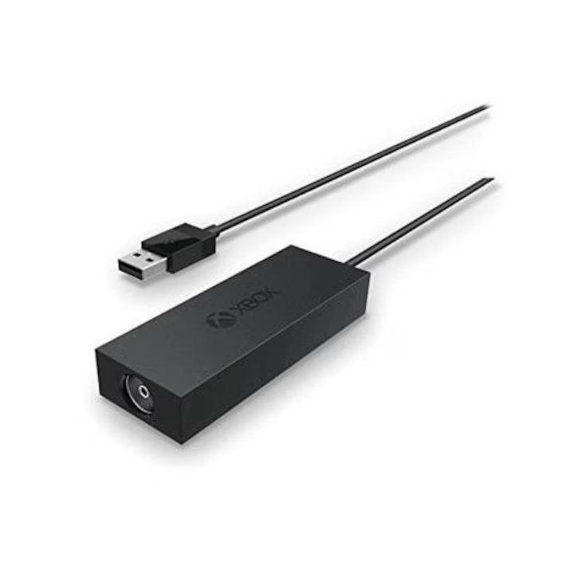

# Dev_XboxOne_QAM256 — Direct Device Module for AltDVB (Windows)

  

Driver nativ de producție în user-space prin **WinUSB** pentru Microsoft Xbox One Digital TV Tuner (`045E:02D5`) în **AltDVB 2.5**.

---

## 📌 Caracteristici Tehnice & Arhitectură
1. **Zero Packet Drops pe QAM-256 (50.87 Mbps):**
   * Puntea **DiB0700** rulează la ceasul maxim de **72 MHz**.
   * Magistrală I2C accelerată la **1000 kHz Fast-Mode Plus**.
   * Tranzacții I2C atomice pe Endpoint 0 (elimină blocajul de FIFO din DiB0700).
   * Demodulatorul **Panasonic MN88472** configurat pe **`VARIABLE_TS_CLOCK`** și mod paralel TS.
   * Streaming asincron prin 16 buffere aliniate paginat (`BULK_STAGESIZE = 24.064 octeți`) pe Bulk Endpoint `0x82`.
2. **Watchdog Automat de Re-achiziție Purtătoare (Hot-Plug Cablu Coaxial):**
   * Monitorizare continuă a semnalului la 400 ms (locked) / 150 ms (căutare).
   * Restartare automată FSM pe Panasonic (`0xF8 = 0x9F`) la căderea de semnal.
   * La reconectarea cablului coaxial TV, stream-ul video/audio își revine automat în `< 1 secundă` fără a fi nevoie de dublu-click pe canal sau restart AltDVB.
3. **Protecție FPU Delphi x87:** Toate punctele de intrare/ieșire din DLL curăță automat starea coprocesorului matematic (`_clear87()`, `fnclex`), prevenind crash-urile din interfața Delphi a AltDVB.

---

## 📌 Recomandări importante pentru redare în AltDVB
1. **Renderer Video:** În AltDVB, la **Settings -> DirectShow Config -> Main -> Video -> Renderer**, selectați **Default Video Renderer** sau **Video Mixing Renderer 9 (VMR-9)**.  
   *(Pe Windows 10/11, „Enhanced Video Renderer / EVR” poate produce ecran negru fără imagine).*
2. **Decodoare DirectShow (32-bit):** AltDVB este o aplicație x86 (32-bit), deci necesită codecuri DirectShow pe 32-bit (ex: **LAV Filters x86** sau **Microsoft DTV-DVD Video Decoder**).

---

## 🚀 Cum se instalează și se folosește

### 1. Asocierea Tunerului cu WinUSB (folosind Zadig)
Deoarece tunerul nu are driver oficial de la Microsoft pentru Windows:
1. Conectează tunerul de Xbox One la un port USB al PC-ului.
2. Descarcă utilitarul gratuit [Zadig](https://zadig.akeo.ie/).
3. Deschide Zadig:
   - Mergi în meniu la **Options** -> bifează **List All Devices**.
   - Din lista derulantă selectează **Xbox One Digital TV Tuner** (verifică să aibă USB ID `045E 02D5`).
   - În câmpul din dreapta săgeții verzi alege **WinUSB** (versiunea implicită Microsoft).
   - Apasă pe butonul **Replace Driver** (sau **Install Driver**).

---

### 2. Copierea fișierelor în AltDVB
1. Copiază fișierele din acest folder direct în directorul **`Devices\`** al instalării tale de AltDVB:
   * `Dev_XboxOne_QAM256.int`
   * `Dev_XboxOne_QAM256.cfg`
2. Pune cele două fișiere de firmware în folderul `Devices\` (sau în rădăcina AltDVB):
   * `dvb-usb-dib0700-1.20.fw`
   * `dvb-demod-mn88472-02.fw`

---

### 3. Utilizarea în AltDVB
1. Pornește **AltDVB**.
2. La pornire (în fereastra *Select Device Interface*), selectează **`Dev_XboxOne_QAM256`**.
3. Tunerul se va inițializa automat prin WinUSB.
4. Mergi la Scanare / Vizionare pe frecvențele DVB-C dorite (de exemplu rețeaua DIGI cablu).
